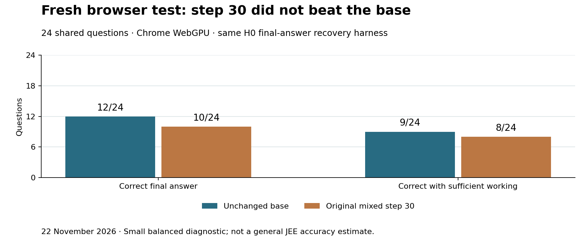

<h1 align="center">LlamaJEE.js</h1>

**Solve IIT JEE questions on your device with an experimental browser model.**

[Try the solver](https://ompatnaik.com/llamajee/)

Desktop WebGPU · no account or inference API · 4B download: about 3.1 GB, plus runtime memory · phone support untested.

Built by Om Patnaik · September–November 2026.

## Try it

| Where | First step |
|---|---|
| Browser | Open the solver, load **4B unchanged base**, then paste a complete text question. |
| Apple Silicon Mac | Run the [original local 9B lab](local_lab/README.md#run-it). |

You get an answer and the model's working. To explore without downloading weights, read the [experiment history](EXPERIMENT_HISTORY.md).

## Why

You should be able to check how a solver reached its answer. This project tests both model training and the code that guides its responses; answers can still be wrong.

## Latest result

**Training has not shown an improvement on our fresh browser test.**



22 November 2026 · **24 shared text questions**, balanced across subjects and Main/Advanced, with the same browser and answering code. This small test does not establish general JEE accuracy.

**Base** is pretrained Qwen3.5-4B without our adjustments. **Step 30** adds our learned adjustments after 30 training updates. Both use the same compressed browser model.

[Full comparison](research/FRESH_BROWSER_COMPARISON_2026_11_22.md) · [Raw aggregate data](research/FRESH_BROWSER_COMPARISON_2026_11_22.json). Rebuild the chart with `python charts/make_fresh_browser_summary.py` (Matplotlib required).

## Explore the work

- [Models, downloads and browser setup](web/README.md) — 4B, archived 9B checkpoints and the smaller 0.8B demo.
- [Training and test history](EXPERIMENT_HISTORY.md) — results, regressions and their test conditions.
- [Mistakes versus training coverage](research/ERRORS_AND_TRAINING_COVERAGE_2026_11_24.md) — what failed and which topics were practiced.
- [Harness code and comparisons](harnesses/) — the code that guides each model's response.

## Notes from building it

I learned that neat working does not guarantee a correct answer. I kept the unchanged model as a control and published the negative results. I separated the full prepared curriculum from the examples each checkpoint actually saw.

## Verify it yourself

From a clone, with Node.js installed:

```bash
npm --prefix web run check    # browser harness and output-handling checks
```

These checks do not download models or measure JEE accuracy. The [4B browser release checks](research/STEP30_BROWSER_RELEASE_2026_11_06.md) record what was verified during conversion and browser testing.

Built on Qwen3.5, MLX/MLX-VLM, ONNX Runtime and Transformers.js. Model metadata declares Apache-2.0; see the [model card and upstream terms](README-DETAILS.md).

[Full model notes](README-DETAILS.md) · [Conversion code](conversion_lab/) · [Issues and lessons](ISSUES_AND_LESSONS.md)
