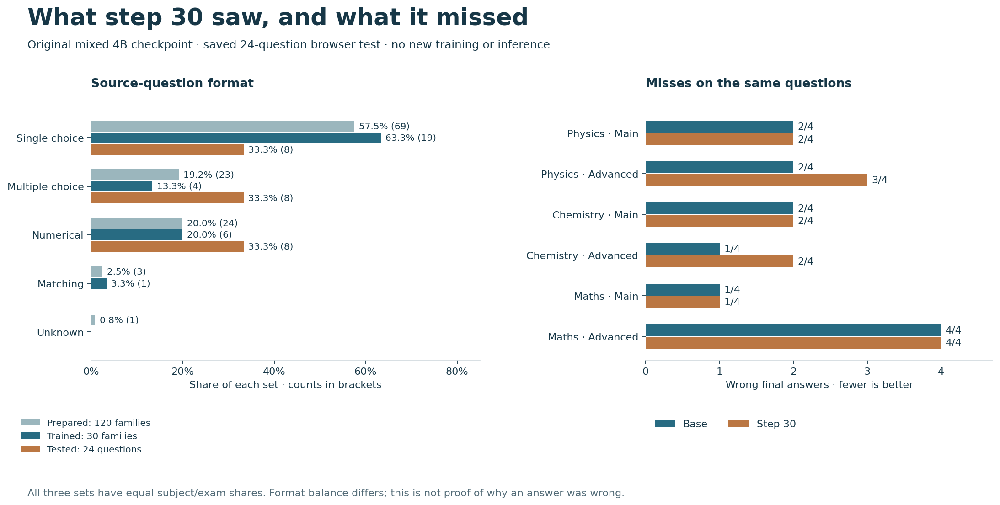

# Missed questions compared with the training set

24 November 2026. **The original mixed step-30 adapter missed 14 of 24 fresh browser questions; the unchanged base missed 12.** Twelve misses were shared and two were new misses with the adapter. This report classifies those saved outcomes and compares them with the training composition. It does not change any score or report a new model run.

## What the earlier graph actually describes

The October graph covers **120 prepared source-problem families and 360 related teaching exercises**. The checkpoint tested in the browser had consumed **30 families and 90 exercises**. The 30 committed training states confirm that each family contributed one complete solution, one method plan and one step-check exercise. Later step-60 checkpoints are separate.

All three sets have equal subject and Main/Advanced shares: 20 families per subject/exam group in the prepared set, five in actual step-30 training, and four questions in the test. The model did not receive all 120 families by step 30.

| Source-question format | Prepared families | Trained families | Test questions |
|---|---:|---:|---:|
| Single choice | 69/120 | 19/30 | 8/24 |
| Multiple choice | 23/120 | 4/30 | 8/24 |
| Numerical | 24/120 | 6/30 | 8/24 |
| Matching | 3/120 | 1/30 | 0/24 |
| Unknown | 1/120 | 0/30 | 0/24 |

Single-choice questions were 63.3% of actual training, versus 33.3% of the test. Multiple-choice questions were 13.3% of actual training, versus 33.3% of the test. This describes a composition difference, not proof that the difference caused the mistakes. Teaching-task types and source-question answer formats are different counts.

## Which types were missed

These are wrong delivered answers, with all tested questions retained in the denominators. Lower is better.

| Subject | Exam | Base misses | Step-30 misses |
|---|---|---:|---:|
| Physics | Main | 2/4 | 2/4 |
| Physics | Advanced | 2/4 | 3/4 |
| Chemistry | Main | 2/4 | 2/4 |
| Chemistry | Advanced | 1/4 | 2/4 |
| Mathematics | Main | 1/4 | 1/4 |
| Mathematics | Advanced | 4/4 | 4/4 |

By answer format, the base missed 4/8 numerical, 3/8 single-choice and 5/8 multiple-choice questions. Step 30 missed 5/8, 3/8 and 6/8 respectively. All four Advanced Mathematics questions were missed by both models. The two new step-30 misses were in Advanced Physics and Advanced Chemistry.

## What the saved work shows

The following labels summarize the main visible failure. A response can have additional reasoning errors; its full case record keeps those. Abstention and an empty selection describe the delivered output, not an established root cause.

| Main observed failure | Base misses | Step-30 misses |
|---|---:|---:|
| Wrong scientific idea or assumption | 5 | 5 |
| Unfinished solution | 3 | 4 |
| Abstained | 1 | 2 |
| Wrong requested quantity | 1 | 1 |
| Invalid empty option selection | 1 | 1 |
| Arithmetic or algebra error | 1 | 1 |

Loops, output limits and format compliance are separate flags. Some correct answers also loop or need recovery. Across all 24 questions, loop flags were 2 for the base and 4 for step 30; both reached the initial token limit on 16 questions. These counts must not be added to the failure categories as extra questions.

One shared physics miss had sufficient calculation but gave the wrong requested quantity in its final line. It stopped normally, so it was not an observed timeout or recovery failure. Other misses contain wrong scientific assumptions or unfinished calculations. There is no single demonstrated cause covering all 14 misses.

## Comparison with topic coverage

Existing source metadata gives actual step-30 training eight primary topics per subject. The full 120-family package has 16 Physics, 23 Chemistry and 19 Mathematics primary topics. These are broad, provisional labels, not calibrated difficulty or proof of method mastery.

Seven of step 30's 14 misses have a primary chapter represented among its 30 training families. Seven do not. For the full test, these groups contain **11 questions with a primary-chapter match (7 misses)** and **13 without one (7 misses)**. This small, selected diagnostic does not show that a missing chapter label caused a miss. Some absent topics were answered correctly, and some represented topics were answered incorrectly.

For example, the consumed training set includes a molality conversion exercise, but both models still mishandled a solution-concentration test question. Refraction, conics and vectors are also represented at chapter level, yet their test questions were missed. The saved per-family rationales are linked privately so broader chapter overlap is not mistaken for practice on the exact decisive method.

The analysis keeps secondary topics as well. A problem involving both electric circuits and heat can have no primary circuit match while still having a related thermal-physics training example. Counts shown here use one primary topic per question and family to avoid double counting.

## What this tells us

The subject balance is intact. The first 30 families cover fewer topics and a different mix of answer formats than the prepared 120-family graph suggests. However, misses occur both where a primary chapter is absent and where related material was trained. The results support targeted diagnosis; they do not establish that simply adding more examples or more training steps will solve the problem.

Correct answers with sufficient decisive working remain 9/24 for the base and 8/24 for step 30. The original comparison still provides no improvement claim. Difficulty is unassigned for the test questions; older training reasoning-demand estimates are not a comparable difficulty scale. All tested questions remain reserved against future training and checkpoint selection.

Source-based automated review and provisional metadata have limits. Primary topics were mapped after the completed test for diagnosis; this is not a preregistered subgroup experiment. No new training, inference, source repair or scientific regrading occurred. The older native 19/24 result uses different conditions and is not the baseline for this comparison.

Evidence: [completed browser comparison](FRESH_BROWSER_COMPARISON_2026_11_22.md), [earlier pilot dataset report](PILOT120_DATASET_2026_10_30.md). Private source questions and answer keys are not included.
