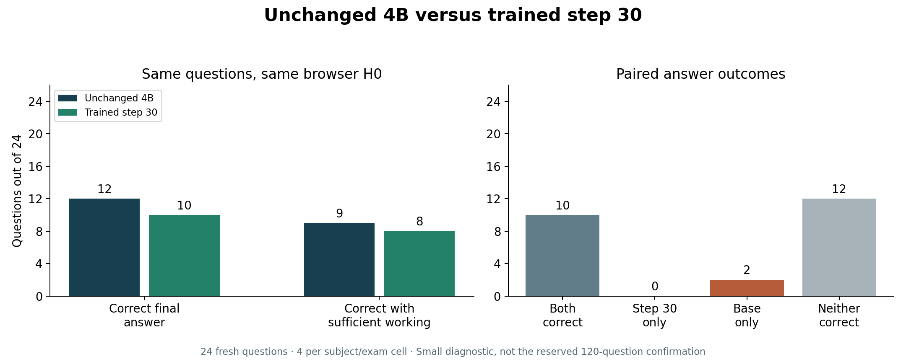

# Fresh browser test: unchanged 4B versus trained step 30

22 November 2026. **The unchanged Qwen3.5-4B answered 12 of 24 questions correctly; the original mixed step-30 adapter answered 10.** Step 30 gained no answers and lost two. This test does not support an improvement claim for the trained checkpoint. No further training ran, and no checkpoint was promoted.

Both models answered the same 24 newly selected questions in Chrome using the same frozen H0 browser harness. H0 gives the model a second call to submit a final answer when its first response reaches the output limit. The comparison used four questions in each Physics/Chemistry/Maths × Main/Advanced group, with eight numeric, eight single-choice and eight multiple-choice questions. This is a small diagnostic, not an estimate of performance across the full JEE syllabus.

| Measurement, out of 24 questions | Unchanged 4B | Step 30 |
|---|---:|---:|
| Correct delivered final answer | **12** | **10** |
| Correct answer with sufficient working | 9 | 8 |
| Correct answer also accepted by the browser's format check | 10 | 9 |
| Correct answer meeting the stricter canonical format rule | 8 | 8 |
| Nonproductive repetition in the working | 2 | 4 |
| First response reached its output limit | 16 | 16 |
| Used final-answer recovery | 16 | 16 |

Ten questions were correct for both models, two only for the base, none only for step 30, and twelve for neither. The two losses were an Advanced optics question and an Advanced chemistry classification question. On the optics question, the base's correct final choice was not backed by sufficient working, while step 30 abstained. On the chemistry question, the base had sufficient decisive working and step 30 made a classification/counting error. The two losses therefore do not represent identical failures.

| Subject and exam | Base correct | Step 30 correct |
|---|---:|---:|
| Physics Main | 2/4 | 2/4 |
| Physics Advanced | 2/4 | 1/4 |
| Chemistry Main | 2/4 | 2/4 |
| Chemistry Advanced | 3/4 | 2/4 |
| Maths Main | 3/4 | 3/4 |
| Maths Advanced | 0/4 | 0/4 |

By answer type, the base and step 30 scored 4/8 and 3/8 on numeric questions, 5/8 each on single-choice questions, and 3/8 and 2/8 on multiple-choice questions. A multiple-choice answer needed the complete correct set; these are question counts, not JEE exam marks with partial credit or penalties.

The shared failures matter. Both models sometimes applied the wrong physical boundary condition, followed a wrong reaction sequence, missed a condition, or stopped before checking every statement. A CHECK heading sometimes repeated the original mistake. One shared response derived the requested coefficient correctly but submitted a different quantity in its final line. Better formatting alone would not repair these scientific errors.

This was not the earlier very-short-output failure mode. Total output per solve, including recovery when used, ranged from 569 to 1,297 tokens for the base and 569 to 1,296 for step 30. Both still produced substantial working, and both frequently exhausted the first-pass budget. The small two-question gap is not proof of a general model collapse or of a particular training mistake.

Scientific correctness, format and procedure were scored separately. A clearly identifiable answer could receive scientific credit despite malformed wrapping. Correct content left only in the draft could not rescue a wrong final answer. The browser's format check accepted 19/24 responses in each condition; the stricter rule also requires exact option strings. A format pass does not establish scientific correctness. Sufficient working means the decisive method and steps support the answer, not that every incidental sentence has been certified.

The fixed settings were text input, greedy decoding, thinking disabled, 1,280 direct output tokens, at most 96 recovery output tokens and a 1,536-token input limit. There were 48 solves and 80 completed generation calls, with no failed stages or scientific retries. Seven of the 32 recovery prompts shortened their drafts to fit, and all stayed within the input limit. Recovery ended with a correct answer after an initially incorrect or unfinished draft in four base cases and three step-30 cases. These are observed draft-to-submission transitions, not a controlled estimate of H0's benefit over an H0-off arm.

All 168 pinned model files and the actual paired requests passed integrity checks. The trained adapter's 18 factor arrays matched the native adapter after the required layout conversion; their graph paths and numerical effect were checked. Sixteen pairs nevertheless had identical direct token sequences. An active adapter can change prediction scores without changing the highest-scoring next token. This confirms adapter application, not useful learning or full native/browser equivalence.

The run used browser model revision `5871c9b3254effce078432f1ea98c4896c4a22d3` from `OmTheLast/LlamaJEE-4B-ONNX-WebGPU` and harness source commit `a4f698ac32ddd6765939bcd802e36d49912bfd34`. Exact cached weight files were served locally; inference ran in Chrome, not through a model API. Median recorded time was about 9.8 minutes per question for each model. Timing includes orchestration on a shared Mac under changing load, so it is not a controlled model-speed comparison or a public download-speed test.

The questions were disjoint from the recorded project exposure ledger, frozen training set and reserved confirmation question IDs before this run. They came from six papers from 2015, 2016 and 2025. Source papers overlap with the reserved confirmation pool; unknown base-model pretraining exposure remains possible. Three defective or ambiguous source candidates were replaced before inference. Two candidates with unused close variants were admitted under a recorded pre-run exception; the selected and related families were reserved against future training/selection. The two related variants were not evaluated. Balance by subject and exam does not imply calibrated difficulty. The separate 120-question confirmation and reserved 2026 questions were not evaluated.

All 48 responses received source-based automated review, with model identities hidden where practical. The coordinator had operational order access, so this was not fully double-blind or expert human certification. An early terminal-response scoring correction was recorded before any completed outputs were inspected; later scoring stayed fixed. A gap in background audit monitoring was detected, preserved and followed by full retrospective checks, then bounded checks through completion. No drift or corrupted result was found.

The older 19/24 result used MLX, the local Mac runtime, under a different evaluation condition. It must not be read as a fall from 19 to 10 on the same test. The defensible conclusion here is narrower: **step 30 did not beat the unchanged model on this fresh, matched browser test.** No website code or model weights changed in this round. Detailed questions, keys and review traces remain private; the completed aggregate and graph are published for the project record.

[Aggregate data and evidence hashes](FRESH_BROWSER_COMPARISON_2026_11_22.json) · [Vector chart](fresh-browser-comparison-2026-11-22.svg) · [Project history](../EXPERIMENT_HISTORY.md)
