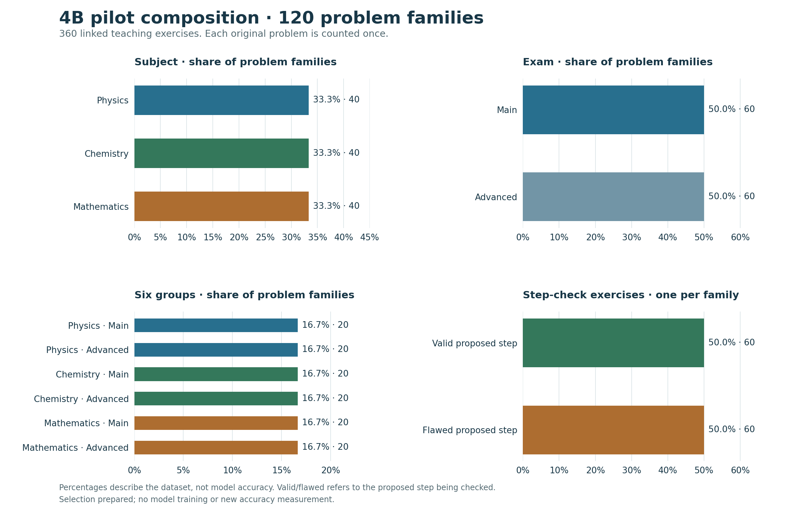

# Balanced 4B pilot dataset — frozen and checked

30 October 2026. **120 distinct recorded problem families and 360 teaching exercises are selected. No model training or new accuracy test ran.** The final package is `pilot120-v2`; the first draft is preserved as a failed candidate.

## Composition

| Subject | Main | Advanced | Total | Share |
|---|---:|---:|---:|---:|
| Physics | 20 | 20 | 40 | 33.3% |
| Chemistry | 20 | 20 | 40 | 33.3% |
| Mathematics | 20 | 20 | 40 | 33.3% |
| Total | 60 | 60 | 120 | 100% |

Each of the six subject/exam groups contains ten valid-step and ten deliberately flawed-step checking exercises. This labels the proposed step being assessed; it does not mean half the final solutions are wrong. Every family also has a method-planning exercise and a complete-solution exercise. The three exercises remain views of one source problem.

The selected problems come from 26 source papers across 2017–2024. Provisional primary-topic labels cover 16 Physics, 23 Chemistry and 19 Mathematics topics. Each group of 20 is capped at six from any one primary topic or source paper. Selection spreads methods, source years, answer formats and reasoning demands within those caps. It does not reproduce the actual topic frequency of JEE papers or establish full syllabus coverage.

Source-assessed answer formats are 69 single-choice (57.5%), 23 multiple-choice (19.2%), 24 numerical (20.0%), three matching (2.5%) and one unknown (0.8%). Estimated reasoning demand is 23 direct (19.2%), 67 routine linked (55.8%) and 30 multiple-constraint (25.0%). These are provisional assessments with written reasons, not calibrated difficulty scores or measured student success rates.

## Selection and quality checks

The starting archive contains 300 families, including 59 existing holds and 241 provisionally supported families. All 241 supported source images received metadata inspection. Ten additional source/input issues were excluded from the pilot, including neighbouring-question crops, irrelevant following-section instructions and one target relying on missing numerical source support.

The first 120-family selection passed structural and processor checks, but independent target review found four selected verification fields saying that a preserved answer reference agreed. A scan of the full supported pool found five such targets. These provide no scientific verification and are excluded from the final selection. The failed first draft, its checks and the original source questions remain preserved.

Final partition of the 300-family archive:

- 120 selected families;
- 106 other supported families available for later selection;
- 59 earlier holds;
- 15 additional pilot exclusions (ten input/source issues and five verification-target defects).

A fixed selection policy and seed were saved before selection; the policy revisions and failed draft remain recorded. Selection minimizes concentration of topics, methods, source papers/years, formats and reasoning demands within exact quotas. It uses no new model outputs or scores. A fresh-process replay with a different Python hash seed reproduced the same selection. One reviewed pair of close variants is restricted to at most one member. A native-text duplicate signal was rejected after image inspection showed shared marking instructions, not equivalent questions.

## Verification result

- All 32 independent checks passed on version 2: quotas, whole families, schema, target preservation, image hashes, duplicate constraints, source bindings, split reservations and unchanged training lock.
- All 337 recorded original input files remain hash-identical. No source question or teaching target was rewritten or deleted during selection.
- All 360 selected exercises passed the pinned Qwen3.5-4B processor: real images present, exact decoded targets, assistant-only masks and no truncation. Total prepared lengths were 214–1,220 tokens, below the 2,048-token limit.
- There is no selected overlap with protected reservation families or exact recorded protected render hashes. Native-text and reviewed-pair screening is not exhaustive semantic leakage detection. Protected question content was not used for selection.
- Charts were inspected visually. Local review links and static filter behavior were checked. Live Chrome testing of the private file was blocked by the browser's local-file URL policy; no workaround was attempted.

The 360 stored exercises contain 78,922 assistant-target tokens: step checking 11,085 (14.0%), method planning 28,815 (36.5%), and complete solving 39,022 (49.4%). Counts of exercises and counts of tokens are different. This describes one copy of each stored exercise, not an adopted training schedule or loss weighting.

## What is still required before training

Freeze the experiment's sampling and loss weighting, answering harness, unchanged baseline and evaluation rules. Prove one small MLX update can be saved, resumed, exported and run faithfully in the browser. The data package does not unlock training by itself. The existing training lock and protected split reservations are unchanged; no 4B adapter has been trained or promoted.

This is machine-reviewed experimental material. Source/target limitations and new pilot exclusions remain visible; review agreement does not certify every scientific solution. Data balance is not evidence that fine-tuning will improve JEE performance.

## Graphs and saved identities

[Topic percentages](../charts/pilot120/topic-composition.png) · [Target-token percentages](../charts/pilot120/token-composition.png) · [Aggregate data and chart notes](../charts/pilot120/README.md).

The frozen private dataset manifest has SHA256 `f33f38028626fe41115d2d8519439eeb2c9cba6a5c9264e667fd65f8af53a328`. The private package and source questions are retained locally. This public update contains aggregate results only; no new model weights or private training/evaluation material are included.
